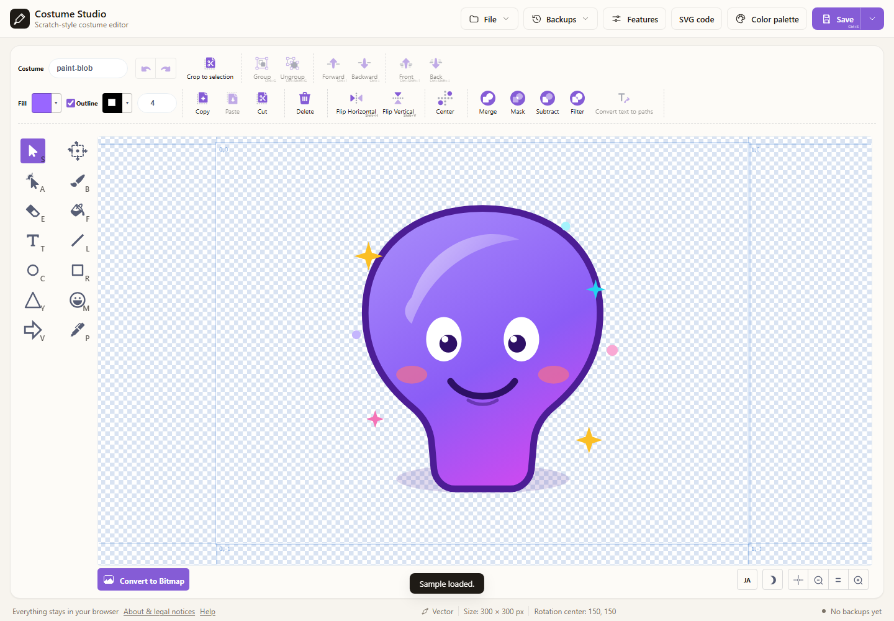

# Costume Studio

Costume Studio is an unofficial, standalone web app that wraps the Scratch paint
editor ([`@scratch/scratch-paint`](https://github.com/scratchfoundation/scratch-paint))
so you can edit and export costumes without a Scratch account or server. Everything
runs in your browser.



> **Unofficial project.** Not affiliated with, endorsed by, or sponsored by the
> Scratch Foundation. Scratch is a trademark of the Scratch Foundation. See
> [TRADEMARK](TRADEMARK).

## Features

- **Scratch paint editor** — select, reshape, brush, eraser, fill, text, line,
  circle, and rectangle tools, layer ordering, grouping, and rotation center.
- **Vector and bitmap modes** — draw vectors and convert to bitmap when needed.
- **Import** — open SVG, PNG, and JPG files by picker or drag and drop.
- **Export** — choose SVG, SVG with text converted to paths, PNG (1×), or PNG (2×) from the
  Save button's dropdown. PNG keeps transparency.
- **Custom fonts** — add a TTF, OTF, WOFF, or WOFF2 file, or a system font by name, and choose a
  fallback font for when it cannot load. Added fonts appear in the text font picker.
  **Convert text to paths** is available from the Select toolbar when text is selected. It turns the
  selected text into editable vector paths in place (with undo), so it displays without the font file.
  The Save dropdown can also export an SVG with text converted to paths.
- **Organized header** — **File** and **Backups** are dropdown menus, and Save has an export-format
  dropdown, keeping the toolbar compact.
- **Editor settings** — enable snapping and configure snap targets individually.
- **Restore points** — create them manually, or enable automatic backups in Features to save one every five minutes while there are unsaved edits. Saving a costume that already has an identical backup is skipped. Each backup shows a small preview. Backups are not pruned when the document is later saved or reloaded; the latest session is not automatically restored.
- **Japanese / English UI** — detected from the browser and switchable from the
  editor's bottom-right controls. The embedded Scratch paint UI follows the selected language too.
- **SVG code editor** — inspect and edit the selected vector object's SVG, then
  apply the edited markup.
- **Responsive toolbars** — less-used operations move into a **More** menu when
  available toolbar width is limited.
- **Keyboard shortcuts** for saving, opening, help, selection history, layer order, flips, grouping, and canvas view. Matching keys are shown in the corner of toolbar buttons and their tooltips. Drag with the middle mouse button to pan.
- **Language and theme** are toggled from the editor's bottom-right controls.
- **Editing aids** — fixed nudge distances, an infinite canvas, custom stage size, repeated stage frames, a reversible outline toggle, and a color palette (mix, complement, HSV→RGB, history).
- **Built-in editor tools** — additional tools and operations are integrated in
  the editor. Some are original additions; others adapt or are informed by
  TurboWarp, PenguinMod, or Scratch Addons (see the provenance notes below).

### Built-in tool list

| Group | Feature | Origin / implementation notes |
| --- | --- | --- |
| Tools | Triangle and arrow tools | Added to this fork; see source and third-party notes |
| Tools | Pen tool (smooth freehand lines) | PenguinMod Pen mode (GPL-3.0), per the project handover notes |
| Tools | Precise transform (numeric move, scale, rotation, with selectable origin) | Original Costume Studio implementation |
| Tools | Stamp tool with shape picker | PenguinMod Sussy tool (GPL-3.0), per the project handover notes |
| Tools | Rounded rectangle tool with corner-radius control | PenguinMod Rounded Rect (GPL-3.0), per the project handover notes |
| Transform | Align / center, flip, group / ungroup | PenguinMod operations (GPL-3.0), per the project handover notes |
| Transform | Boolean ops (unite / mask / subtract / exclude) | PenguinMod operations (GPL-3.0), per the project handover notes |
| Transform | Line cap / join (round / square / miter / bevel) | PenguinMod operations (GPL-3.0), per the project handover notes |
| Transform | Brush / eraser smoothing | TurboWarp paint editor (GPL-3.0), per the project handover notes |
| Transform | Rectangle corner-radius control | PenguinMod Rounded Rect (GPL-3.0), per the project handover notes |
| Color | Hex color picker and opacity slider | TurboWarp `tw-paint` (GPL-3.0), per the project handover notes |
| Transform | Snap to guides when moving | Independently implemented from documented Scratch Addons `paint-snap` behavior; no addon source bundled |
| Transform | Image crop (crop to selection; bitmap trims transparent edges) | Uses the vendored Scratch paint bitmap helpers |
| View | Dark theme | Original UI integration; some theme behavior adapted from TurboWarp paint code |
| Editing | SVG code panel for selected objects | Original Costume Studio implementation |

SVG cleanup is always on. Raster images are embedded at source pixel resolution in an SVG costume wrapper, scaled to fit a 480×360 costume viewport; a fallback bitmap path may scale to at most 960×720. GIF uses its first frame. BMP files are recognized by the reader but are not listed in the file-picker filter.

**Out of scope:** the full TurboWarp / PenguinMOD editors (blocks, VM, cloud
variables, packager, site features) and Scratch Addons that are not about
costume editing. This app includes selected modifications and code adapted from
GPL-3.0 paint forks; the notices below identify known sources.

## Using the app

1. Start with **New** for a blank canvas, or open the **sample** from the help dialog.
2. Pick a tool from the left palette and draw on the canvas.
3. For precise transforms, choose **Precise Transform** and select vector objects on the canvas. Enter numeric move, scale, or rotation values and apply them; scale and rotation use the chosen pivot.
4. Use the **Save** button, or its dropdown, to choose an export format. Use **File → Import** to add an image to the current costume without clearing it.
5. To resume later, restore a point from **Backups**. The current session is not automatically restored after reloading.

### Shortcuts

| Action | Keys |
| --- | --- |
| Save in the current format | `Ctrl` / `⌘` + `S` |
| Save as SVG | `Ctrl` / `⌘` + `Shift` + `S` |
| Open a file | `Ctrl` / `⌘` + `O` |
| Undo / redo | `Ctrl` / `⌘` + `Z` / `Shift` + `Z` |
| Copy / paste / cut | `Ctrl` / `⌘` + `C` / `V` / `X` |
| Select all | `Ctrl` / `⌘` + `A` |
| Delete selection | `Delete` / `Backspace` |
| Nudge selection | `←` `↑` `→` `↓` |
| Open help | `?` |
| Precise transform | Select the dedicated tool; enter numeric values |

## Run locally

**Requirements:** Node.js 20 or newer (development used Node.js 22) and npm.

```bash
npm install
npm start
```

Open `http://localhost:5173` if your browser does not open automatically.

Production build:

```bash
npm run build
npm run preview
```

`npm run preview` serves `dist/` at `http://localhost:4173`.

## Deploy to GitHub Pages

The repository includes a GitHub Pages workflow at `.github/workflows/deploy.yml`.
Build output uses relative paths, so it works from a project subpath as well.

1. Create a repository and push the `main` branch.
2. In **Settings → Pages → Build and deployment → Source**, choose
   **GitHub Actions**.
3. Pushes to `main` build and deploy automatically. You can also run
   **Actions → Deploy to GitHub Pages → Run workflow** manually.

### Publishing URL

This repository is published at `https://github.com/PixelNest256/costume-studio`. The URLs in `package.json`, `src/App.jsx`, and the README files are set to that location.

## How it works

- `src/index.jsx` creates the Redux store and `IntlProvider`, then renders
  `PaintEditor` from `@scratch/scratch-paint`.
- The Scratch paint reducer is mounted at `state.scratchPaint` as required by the
  editor.
- `onUpdateImage` receives either an SVG string (vector) or `ImageData` (bitmap)
  and stores it in app state.
- PNG export of vector artwork uses `inlineSvgFonts` from
  `@scratch/scratch-svg-renderer` before rasterizing, so text keeps its font.
- Restore points use `costume-studio.backups.v1`, with a maximum of 10 entries and about 4.5 MB total. Automatic backups are enabled by default and run every five minutes while the document is dirty; they can be disabled in Features. The timer restarts after edits. When an identical costume is already saved, the new backup is skipped. Backups remain until the limit is reached or they are manually deleted. The app starts blank after reload; it does not automatically restore.
- Added fonts are stored in IndexedDB (`costume-studio-custom-fonts`) in this browser, up to 20 fonts of at most 15 MB each. A system font is referenced by name and uses the selected fallback if it is unavailable.
- **Convert text to paths** converts the selected text from the Select toolbar (built-in fonts use the bundled font outlines; added fonts use their own). System fonts without outline data stay as text. The conversion is undoable.
- SVG export and PNG rasterizing also convert text that has outline data; `textPath` and `textLength` content stays as text and is reported.
- Imported files are capped at 15 MB.

## Known limitations

- Precise transforms are for vector objects. Standard select/drag transforms are also available.
- The SVG code panel edits the selected object; multi-selection is exposed as a group SVG.
- As in Scratch, **exported SVG and PNG files are trimmed to the artwork bounds**,
  not the full artboard.
- The rotation center is kept in restore points, but it is not stored inside
  exported SVG or PNG files. Reopening an exported file uses the default center.
- Imported bitmaps are handled at their native pixel size.
- Backups are per browser and per origin; they do not follow you to another browser
  or a private window.
- Browser storage limits or settings can prevent saving backups.
- This is not the complete Scratch editor: there is no stage, sprite list, blocks,
  or audio.
- Raster imports are embedded at source resolution inside an SVG costume, scaled to fit a 480×360 costume viewport; if that route fails, the bitmap fallback may scale down to 960×720. GIF animation is not retained (the first frame is used).
- The editor embeds Noto Sans, Source Serif Pro, and Handlee. `Scratch.ttf`, Pixel, Marker, and Curly are omitted from the browser font payload and fall back to Sans Serif; see the font provenance note.

## Privacy

Importing, editing, and exporting happen entirely in the browser. There are no
accounts, analytics, ads, or uploads. The app itself is delivered by a normal web
server (for example, GitHub Pages).

## License

This project is released under the **GNU Affero General Public License v3.0 only
(AGPL-3.0-only)**. Its core editor, SVG renderer, and UI translations
(`@scratch/scratch-paint`, `@scratch/scratch-svg-renderer`, and `scratch-l10n`)
are AGPL-3.0-only. The project also includes GPL-3.0 code adapted in the
vendored paint fork; GPLv3 §13 permits combination with AGPLv3. See
[THIRD_PARTY_NOTICES.md](THIRD_PARTY_NOTICES.md) for component provenance,
license notices, and font details. The corresponding source, including local modifications, is provided here. Provenance notes identify known adapted code; they are not yet a verified file-by-file inventory.

- Full license: [LICENSE](LICENSE)
- Copyright and attribution: [NOTICE](NOTICE)
- Third-party software: [THIRD_PARTY_NOTICES.md](THIRD_PARTY_NOTICES.md)
- Full third-party license texts in builds: `dist/THIRD_PARTY_LICENSES.txt` (generated by `npm run build`)
- GPL-3.0 portions: [LICENSE-GPL-3.0](LICENSE-GPL-3.0)
- GPL modification/provenance record: [src/vendor/scratch-paint/MODIFICATIONS.md](src/vendor/scratch-paint/MODIFICATIONS.md)
- Bundled font license: [OFL.txt](OFL.txt)
- Font provenance: [scratch-render-fonts-PROVENANCE.md](scratch-render-fonts-PROVENANCE.md)
- Excluded Pixel font attribution: [Grand9K-Pixel-ATTRIBUTION.md](Grand9K-Pixel-ATTRIBUTION.md)
- Trademark notice: [TRADEMARK](TRADEMARK)
- Contributing: [CONTRIBUTING.md](CONTRIBUTING.md)
- Security: [SECURITY.md](SECURITY.md)

AGPL §13 requires operators of a modified version offered for remote network interaction to provide users an opportunity to obtain the corresponding source. The corresponding source is provided at `https://github.com/PixelNest256/costume-studio`; ensure it matches the source used for the deployed build.

## Credits

- [Scratch Foundation](https://www.scratchfoundation.org/) and the Scratch
  open-source community
- [scratch-paint](https://github.com/scratchfoundation/scratch-paint),
  [scratch-svg-renderer](https://github.com/scratchfoundation/scratch-svg-renderer),
  [scratch-l10n](https://github.com/scratchfoundation/scratch-l10n),
  [Paper.js](https://github.com/scratchfoundation/paper.js), and [CodeMirror 6](https://codemirror.net/)
- Fonts: [scratch-render-fonts](https://github.com/scratchfoundation/scratch-render-fonts);
  the browser build includes only selected OFL-marked fonts. See THIRD_PARTY_NOTICES.md.

The bundled sample illustration was created for this project.

---

日本語のドキュメント: [README.md](README.md)
