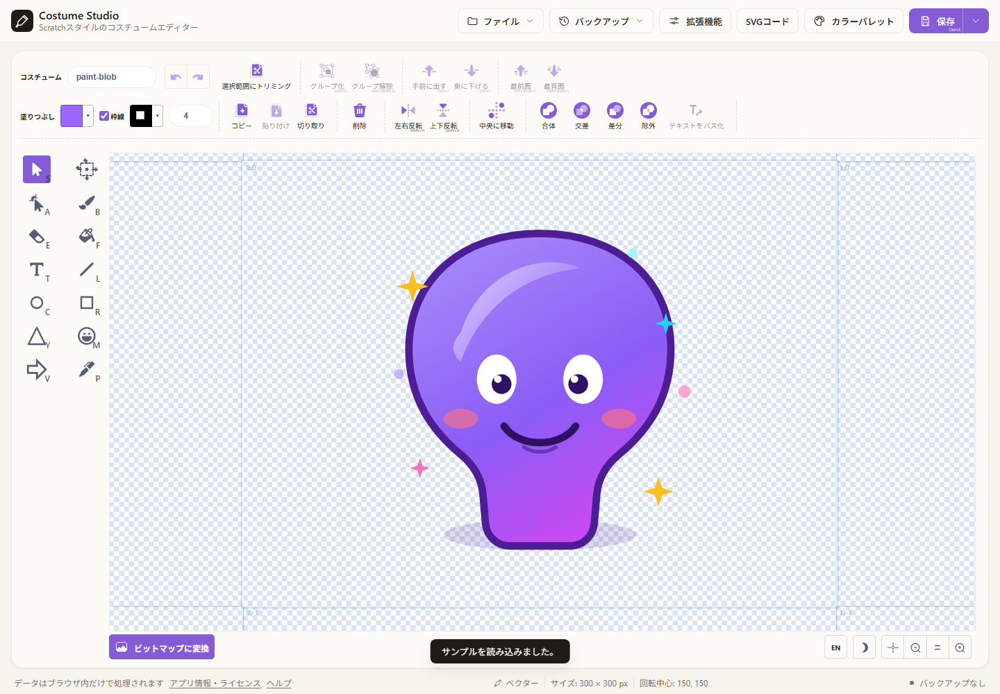

# Costume Studio

Scratch のペイントエディター（[`@scratch/scratch-paint`](https://github.com/scratchfoundation/scratch-paint)）を、単体で使える Web アプリとして包んだ非公式のコスチューム編集ツールです。Scratch のアカウントやサーバーは不要で、画像はすべてブラウザ内で処理されます。

**公開ページ:** [https://pixelnest256.github.io/costume-studio/](https://pixelnest256.github.io/costume-studio/)



> **非公式ツールです。** Scratch Foundation とは提携・承認関係にありません。Scratch は Scratch Foundation の商標です。詳しくは [TRADEMARK](TRADEMARK) を参照してください。

## 特徴

- **Scratch と同じ編集エンジン** — 選択・変形・ブラシ・消しゴム・塗りつぶし・テキスト・直線・円・四角形、レイヤー順、グループ化、回転中心などをそのまま利用できます。
- **ベクター / ビットマップ** — ベクターで描画し、必要に応じてビットマップに変換できます。
- **精密変形（ベクターのみ）** — 左側の専用ツールで選択した図形を数値移動・拡大縮小・回転。拡大縮小と回転の基準点も指定できます。
- **読み込み** — SVG・PNG・JPG に対応。ファイル選択のほか、ウィンドウへのドラッグ＆ドロップでも開けます。**ファイル → 読み込み** では、今のコスチュームを消さずに画像を追加できます。
- **書き出し** — 保存ボタンのドロップダウンから SVG、SVG（テキストをパス化）、PNG（1 倍）、PNG（2 倍）を選択できます。PNG は透過を保持します。
- **カスタムフォント** — TTF・OTF・WOFF・WOFF2 のファイル、または端末のシステムフォント名を追加できます。読み込めない場合に備えてフォールバックフォントも指定できます。追加したフォントはテキストツールのフォント一覧に表示されます。選択ツールの「テキストをパス化」で、選択中のテキストをその場で編集可能なパスに変換できます（元に戻せます）。保存ボタンのドロップダウンからパス化した SVG を書き出すこともできます。
- **整理されたヘッダー** — **ファイル**・**バックアップ**・保存形式のドロップダウンをまとめ、ツールバーをすっきり保ちます。
- **エディタ設定** — スナップの有効化や吸着先を個別に切り替えられます。
- **バックアップ（復元ポイント）** — 編集中の内容をページ再読み込み後に自動復元する機能はありません。手動で作成できるほか、機能設定の「自動バックアップ」を有効にすると、未保存の変更がある間は5分ごと（編集するとタイマーをリセット）に復元ポイントを作成します。同じ内容のコスチュームが保存済みの場合は重複して作成しません。一覧には小さなプレビューが表示され、復元・削除できます。サーバーへの送信はありません。
- **編集ツールの More メニュー** — 横幅が狭いときは、コピー・削除・反転などの操作を More にまとめて表示します。
- **日本語 / 英語 UI** — ブラウザの言語を自動判定し、エディタ右下のコントロールで切り替えられます。Scratch ペイントエディター本体の UI も連動します。
- **SVG コードエディター** — 選択したベクターオブジェクトの SVG を表示・編集し、反映できます。
- **キーボード操作** — 保存・読み込み・ヘルプに加え、選択履歴、レイヤー順、反転、グループ化のショートカットを用意しています。各ボタンの右下にも対応キーを表示します。
- **編集支援** — 矢印移動の距離を固定するオプション、無限キャンバス、ステージサイズ変更、ステージ枠の繰り返し、枠線の一時無効化、カラーパレット（混色・補色・HSV→RGB・履歴）を利用できます。
- **言語・テーマ** — エディタ右下のコントロールから切り替えられます。
- **エディタ内蔵ツール** — 三角形、矢印、ペン、スタンプ、角丸四角形、スナップ、精密変形などをエディタ本体に追加しています。一部は独自実装で、一部は TurboWarp / PenguinMod の GPL-3.0 コードを改変しています。出典とライセンスの詳細は [THIRD_PARTY_NOTICES.md](THIRD_PARTY_NOTICES.md) を参照してください。

### エディタ内蔵ツール一覧

| 分類 | 機能 | 元の着想 |
| --- | --- | --- |
| ツール | 三角形・矢印ツール | 独自追加ツール |
| ツール | ペンツール（ドラッグで滑らかな線を描く） | PenguinMod Pen mode（GPL-3.0、引継ぎ記録に基づく） |
| ツール | 精密変形（数値で移動・拡大縮小・回転、変形基準点を指定） | Costume Studio 独自実装 |
| ツール | スタンプツール（図形をドラッグで配置、図形選択付き） | PenguinMod Sussy tool（GPL-3.0、引継ぎ記録に基づく） |
| ツール | 角丸四角形ツール（角丸サイズ調整付き） | PenguinMod Rounded Rect（GPL-3.0、引継ぎ記録に基づく） |
| 変換 | 図形の整列・中央揃え、反転、グループ化/解除 | PenguinMod の操作（GPL-3.0、引継ぎ記録に基づく） |
| 変換 | ブーリアン演算（合体/マスク/差/除外） | PenguinMod の操作（GPL-3.0、引継ぎ記録に基づく） |
| 変換 | 線の端・結合の丸め/角丸め/面取り | PenguinMod の操作（GPL-3.0、引継ぎ記録に基づく） |
| 変換 | ブラシ・消しゴムの平滑化（スムージング） | 独自追加ツール |
| 変換 | 四角形の角丸サイズ調整 | 独自追加ツール |
| 色 | 16 進数カラーピッカー（6 桁・8 桁、カラー入力付き） | TurboWarp `tw-paint`（GPL-3.0、引継ぎ記録に基づく） |
| 色 | 透明度（不透明度）スライダー | TurboWarp `tw-paint`（GPL-3.0、引継ぎ記録に基づく） |
| 変換 | グリッド／ガイドへのスナップ（選択移動時、ページ中心・辺・他オブジェクトへ吸着、ガイド表示。吸着先／吸着元を個別にオンオフ可） | Scratch Addons `paint-snap` の公開仕様を参考に独自実装（アドオンコードは同梱せず） |
| 変換 | 移動中に Ctrl で一時的にスナップ無効化（既定オン） | 独自実装 |
| 変換 | 画像切り抜き（選択範囲へのトリミング。ビットマップは透明辺を除去） | vendored Scratch paint のビットマップヘルパーを利用 |
| 読み込み | SVG・ラスター画像の正規化、ラスター画像の高解像度 SVG ラッパー化 | Scratch / TurboWarp の挙動を参考に独自実装 |
| 変換 | 貼り付け時に元の位置を保持（ずらさない、既定オン） | `copy-paste-hoc` の paste offset 制御 |
| 表示 | ダークテーマ（テーマボタン、キャンバス背景・エディタ UI・外側 UI） | UI は独自実装、一部の挙動は TurboWarp paint を参考・改変 |
| 表示 | More メニュー（狭いときに一部の操作をまとめる） | ウィンドウ幅に応じたレスポンシブ表示 |
| 編集 | SVG コードパネル（選択オブジェクトの表示・編集） | Costume Studio 独自実装 |

読み込み時の SVG 整形は常時有効です。ラスター画像は元ピクセル解像度を埋め込んだ SVG コスチュームとして読み込み、480×360 の表示領域に収まるように配置します。フォールバック経路では最大 960×720 に縮小する場合があります。GIF は先頭フレームを使います。

**参照元について**: 一部の機能は TurboWarp、PenguinMod、Scratch Addons のコードを改変または挙動を参考に実装しています。TurboWarp / PenguinMod 由来として記録されている箇所には GPL-3.0 コードの改変部分があります。出典・ライセンスの注意と確認済み範囲は [THIRD_PARTY_NOTICES.md](THIRD_PARTY_NOTICES.md) を参照してください。ファイル単位の由来一覧は未完了です。

## 使い方

1. **新規** で空のキャンバスを開くか、**サンプル**（ヘルプ内）で動作を確認します。
2. 左のツールパレットからツールを選び、キャンバスに描きます。
3. 精密変形を使うには左の「精密変形」を選び、キャンバス上でベクター図形を選択します。数値欄で移動・拡大縮小・回転を設定し、それぞれの適用ボタンを押します。
4. **保存** ボタン、またはそのドロップダウンから形式を選んで書き出します。**ファイル → 読み込み** では、今のコスチュームを消さずに画像を追加できます。
5. 続きから始めたいときは、バックアップ一覧から復元ポイントを復元します。自動復元は行いません。

### ショートカット

| 操作 | キー |
| --- | --- |
| 現在の形式で保存 | `Ctrl` / `⌘` + `S` |
| SVG で保存 | `Ctrl` / `⌘` + `Shift` + `S` |
| ファイルを開く | `Ctrl` / `⌘` + `O` |
| 元に戻す / やり直す | `Ctrl` / `⌘` + `Z` / `Y` / `Shift` + `Z` |
| コピー / 貼り付け / 切り取り | `Ctrl` / `⌘` + `C` / `V` / `X` |
| すべて選択 | `Ctrl` / `⌘` + `A` |
| 選択したものを削除 | `Delete` / `Backspace` |
| 選択したものを移動 | `←` `↑` `→` `↓`（`Shift` で15倍） |
| 前後・最前面・最背面へ移動 | `Ctrl` / `⌘` + `↑` / `↓`、`Ctrl` / `⌘` + `Shift` + `↑` / `↓` |
| グループ化 / 解除 | `Ctrl` / `⌘` + `G` / `Ctrl` / `⌘` + `Shift` + `G` |
| 左右反転 / 上下反転 | `Shift` + `H` / `Shift` + `V` |
| 選択履歴を前後に移動 | `Tab` / `Shift` + `Tab` |
| ズームを標準に戻す / 視点とズームを標準に戻す | `Ctrl` / `⌘` + `0` / `Ctrl` / `⌘` + `Shift` + `0` |
| ヘルプを開く | `?` |
| 精密変形 | 専用ツール（数値操作） |

## ローカルで動かす

**必要なもの:** Node.js 20 以上（開発時は Node.js 22 を使用）と npm。

```bash
npm install
npm start
```

`http://localhost:5173` が開きます（自動では開かない場合は手動でアクセスしてください）。

本番ビルドと確認:

```bash
npm run build
npm run preview
```

`npm run preview` は `dist/` を `http://localhost:4173` で配信します。

## GitHub Pages への公開

このリポジトリには GitHub Pages 用のワークフロー（`.github/workflows/deploy.yml`）が含まれています。ビルド成果物は相対パスで出力されるため、プロジェクトページのサブパスでも動作します。ブラウザでアプリを配信する場合は、**対応するソースコードの公開先も利用者に提示**してください（AGPL-3.0-only §13）。

1. リポジトリを作成して `main` ブランチに push します。
2. GitHub の **Settings → Pages → Build and deployment → Source** で **GitHub Actions** を選びます。
3. `main` に push すると自動でビルド・公開されます。手動実行は **Actions → Deploy to GitHub Pages → Run workflow** から行えます。

### 公開先

このリポジトリの公開先は `https://github.com/PixelNest256/costume-studio` です。`package.json`、`src/App.jsx`、README の URL は同じ公開先に揃えています。

> 開発者向けの詳細（構成、`scratch-paint` のフォーク方法、既知の問題、検証手順）は
> [docs/HANDOVER.md](docs/HANDOVER.md) にまとめています。

## 仕組み

- `src/index.jsx` が Redux ストアと `IntlProvider` を用意し、`@scratch/scratch-paint` の `PaintEditor` を描画します。
- Scratch ペイントエディターは `state.scratchPaint` を必要とするため、`ScratchPaintReducer` を組み込んでいます。
- `onUpdateImage` で SVG 文字列（ベクター）または `ImageData`（ビットマップ）を受け取り、アプリ側の状態に反映します。
- SVG の PNG 化には `@scratch/scratch-svg-renderer` の `inlineSvgFonts` を使い、テキストのフォントを埋め込んでからラスタライズします。
- バックアップ（復元ポイント）は `costume-studio.backups.v1` キーに最大10件（合計約 4.5 MB まで）保存します。自動バックアップは既定で有効で、未保存の変更がある場合は5分ごとに保存します（機能設定で無効化可能）。編集があればタイマーをリセットします。同じ内容のバックアップがすでにある場合は作成しません。バックアップは最大件数に達するか手動削除するまで残ります。ページ読み込み時に前回の状態は自動復元しません。
- 追加したフォントは IndexedDB（`costume-studio-custom-fonts`）にこのブラウザ内で保存されます（最大20個、1ファイル15 MB）。システムフォントは名前で参照し、利用できない場合は選んだフォールバックで表示します。
- 「テキストをパス化」は、選択ツールで選択中のテキストをその場でパスに変換します（元に戻せます）。組み込みフォントは同梱フォントの輪郭、追加フォントはそのフォントの輪郭を使用します。輪郭データを持たないシステムフォントはテキストのまま残ります。
- SVG 書き出し時と PNG ラスタライズ時にも、輪郭データを持つテキストをパス化します。`textPath` や `textLength` を含む文字はテキストのまま残り、その旨を通知します。
- 読み込めるファイルは 15 MB までです。GIF は先頭フレームを使います。一般的なラスター画像は元ピクセル解像度の埋め込み画像を持つベクターコスチュームとして読み込みます。
- ブーリアン演算・整列などのエディタ内蔵ツールは Paper.js（`@scratch/paper`）で直接処理し、テキストは演算対象外です。
- 三角・矢印・ペン・スタンプ・精密変形はベクター専用で、ビットマップモードでは表示されません。

## 制限事項

- 精密変形はベクターオブジェクト用です。通常のベクター選択・ドラッグ変形も利用できます。
- SVG コードパネルでは選択オブジェクトを編集します。複数選択はグループ SVG として編集されます。
- Scratch のコスチュームと同じく、**書き出される SVG / PNG は絵の内容に合わせてトリミングされます**（アートボード全体ではありません）。
- 回転中心はバックアップには保持されますが、SVG / PNG ファイル自体には含まれません。書き出したファイルを開き直すと、既定の回転中心になります。
- ラスター画像は元ピクセル解像度を埋め込んだ SVG として 480×360 の表示領域に配置します。SVG 化に失敗した場合のビットマップ経路では、最大 960×720 に縮小することがあります。
- バックアップはブラウザごと・オリジンごとです。別のブラウザやシークレットウィンドウには引き継がれません。
- ブラウザのストレージ容量や設定によってはバックアップに失敗することがあります。その場合はトーストで通知します。
- Scratch の完全なエディターではありません。ステージ、スプライト、ブロック、音声などは含みません。
- 同梱フォントには個別の利用条件があります。ブラウザ用フォント payload には、OFL 表記を確認した Noto Sans、Source Serif Pro、Handlee のみを含めています。`Scratch.ttf`、Pixel、Marker、Curly は含まず、Sans Serif にフォールバックします。詳細はフォント来歴の記録をご覧ください。

## プライバシー

画像の読み込み・編集・書き出しはすべてブラウザ内で完結します。アカウント、解析、広告、画像のアップロードはありません。明示的に選択された restore point はブラウザの localStorage に保存されます。通常の Web サーバー（GitHub Pages など）はアプリ配信時にブラウザからの接続情報を受け取ります。

## ライセンス

このプロジェクトは **GNU Affero General Public License v3.0 only（AGPL-3.0-only）** で公開されています。中核の `@scratch/scratch-paint` / `@scratch/scratch-svg-renderer` と UI 翻訳 `scratch-l10n` は AGPL-3.0-only です。また、vendored paint fork には GPL-3.0 の TurboWarp / PenguinMod コードを改変した部分があると引継ぎ記録に記載されています。GPLv3 §13 は AGPLv3 との組み合わせを許可しています。対応ソース一式はこのリポジトリで提供しますが、ファイル単位の由来一覧は未完了です。依存関係・フォント・外部プロジェクトの出典とライセンスの説明は [THIRD_PARTY_NOTICES.md](THIRD_PARTY_NOTICES.md) を参照してください。

- ライセンス全文: [LICENSE](LICENSE)
- 著作権・帰属表示: [NOTICE](NOTICE)
- 第三者ソフトウェア: [THIRD_PARTY_NOTICES.md](THIRD_PARTY_NOTICES.md)
- ビルド成果物の第三者ライセンス全文: `dist/THIRD_PARTY_LICENSES.txt`（`npm run build` で生成）
- GPL-3.0 部分のライセンス: [LICENSE-GPL-3.0](LICENSE-GPL-3.0)
- GPL 部分の改変・由来: [src/vendor/scratch-paint/MODIFICATIONS.md](src/vendor/scratch-paint/MODIFICATIONS.md)
- 同梱フォントのライセンス: [OFL.txt](OFL.txt)
- フォント来歴: [scratch-render-fonts-PROVENANCE.md](scratch-render-fonts-PROVENANCE.md)
- 除外した Pixel フォントの帰属: [Grand9K-Pixel-ATTRIBUTION.md](Grand9K-Pixel-ATTRIBUTION.md)
- 商標について: [TRADEMARK](TRADEMARK)
- コントリビューション: [CONTRIBUTING.md](CONTRIBUTING.md)
- セキュリティ: [SECURITY.md](SECURITY.md)

AGPL に従い、改変版をネットワーク経由で利用させる場合は、実際に提供する改変版の対応ソースコードを、利用者が取得できる形で提示する必要があります。対応するソースは `https://github.com/PixelNest256/costume-studio` で提供し、配信するソースがビルド内容に一致していることを確認してください。

## クレジット

- [Scratch Foundation](https://www.scratchfoundation.org/) と Scratch オープンソースコミュニティ
- [scratch-paint](https://github.com/scratchfoundation/scratch-paint)、[scratch-svg-renderer](https://github.com/scratchfoundation/scratch-svg-renderer)、[scratch-l10n](https://github.com/scratchfoundation/scratch-l10n)、[@scratch/paper](https://github.com/scratchfoundation/paper.js)
- UI: React、Redux、react-intl、[CodeMirror 6](https://codemirror.net/)
- フォント: [scratch-render-fonts](https://github.com/scratchfoundation/scratch-render-fonts)（ブラウザ版には一部の OFL 表記フォントのみ同梱。詳細は THIRD_PARTY_NOTICES.md 参照）

サンプルとして同梱しているイラストは、このプロジェクト用に作成したオリジナル作品です。

---

English documentation: [README.en.md](README.en.md)
